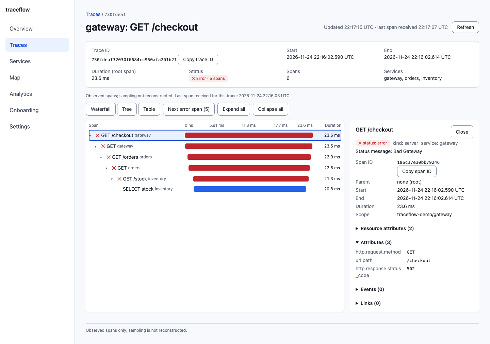
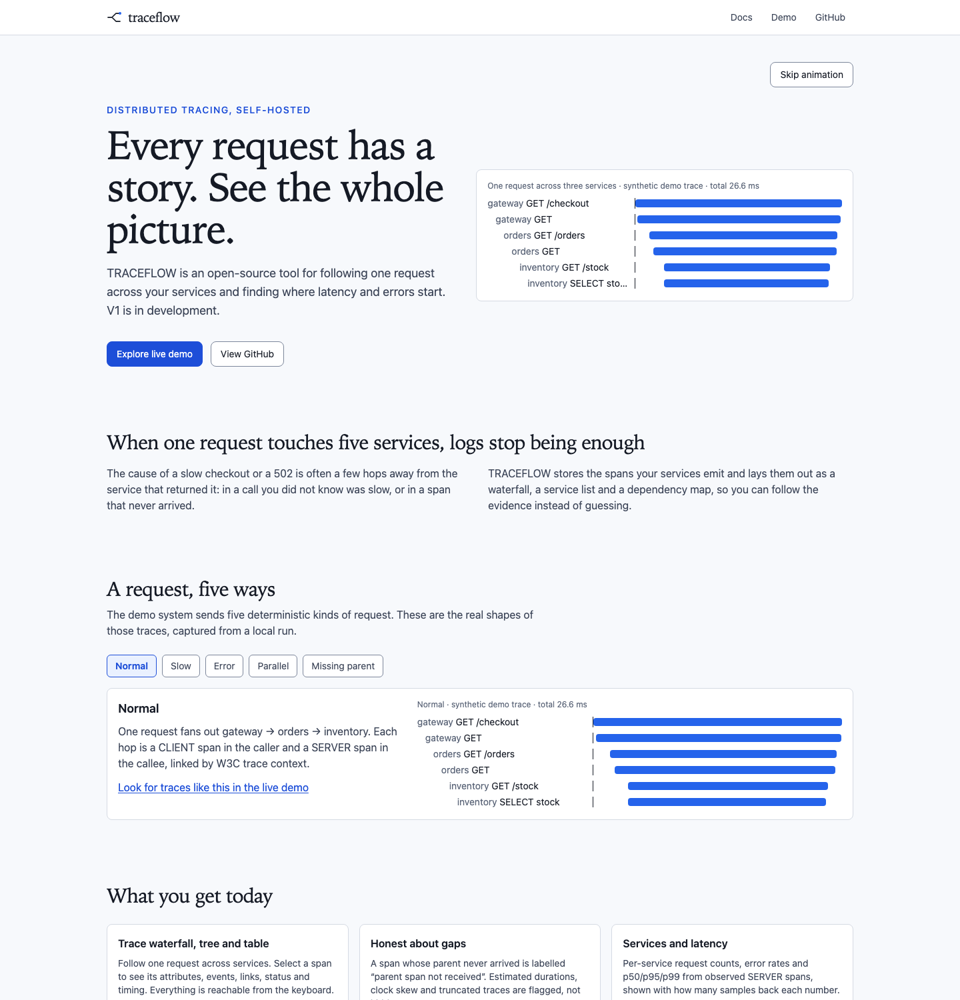
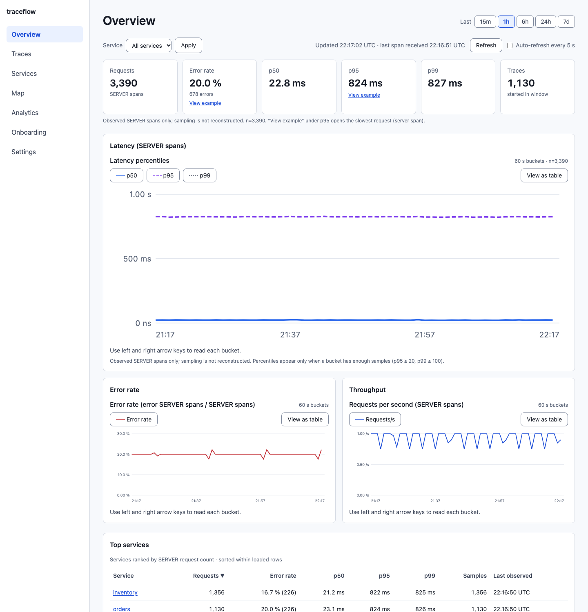
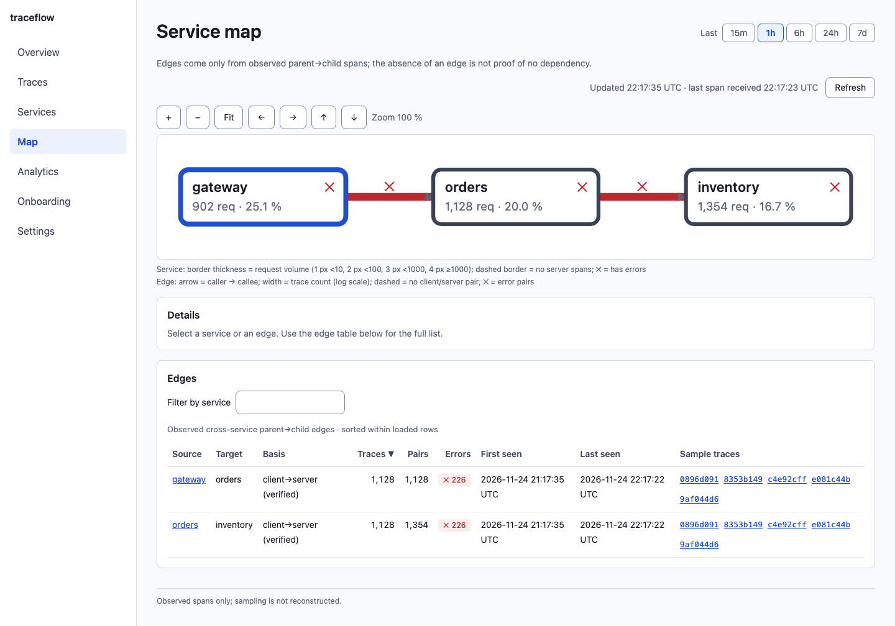
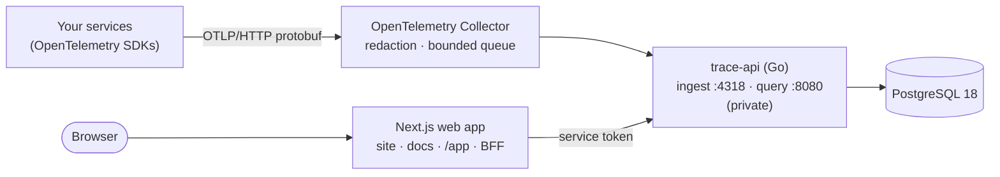

<div align="center">

# TRACEFLOW

**Every request has a story. See the whole picture.**

Self-hostable, open-source distributed tracing. Send OpenTelemetry traces, then find slow and failing requests, follow them across services, and see which services call which, from recorded evidence only.

[](https://github.com/Sendiw14/Traceflow/actions/workflows/ci.yml)
&nbsp;Apache-2.0&nbsp;·&nbsp;Go + PostgreSQL + Next.js&nbsp;·&nbsp;**V1 in development**



</div>

## Why TRACEFLOW

When one request touches several services, the cause of a slow checkout or a 502 is often a few hops away from the service that returned it. TRACEFLOW stores the spans your services emit and lays them out so you can follow the evidence instead of guessing.

- **Real OpenTelemetry in.** OTLP/HTTP binary Protobuf through a pinned OpenTelemetry Collector. A request is acknowledged only after it is committed to PostgreSQL.
- **Honest about gaps.** A span whose parent never arrived is labelled "parent span not received". Estimated durations, clock skew and truncated traces are flagged, never smoothed over. Every aggregate says which spans it covers and how many samples back it.
- **Evidence-only service map.** An edge exists only where a recorded parent span in one service has a child span in another. A missing edge is never presented as proof of no dependency.
- **Diagnostics you can use without a mouse.** Waterfall, tree and table views of every trace, a keyboard-reachable service map with an edge table, and charts with a "view as table" alternative.
- **Private by default.** The query API and ingest listener are never published, sensitive attributes are redacted before storage, and the dashboard needs GitHub sign-in on a hosted deployment.
- **Small and self-hostable.** One Go service, one PostgreSQL database and one Next.js app, run with Docker Compose.

## See it

<table>
  <tr>
    <td width="50%"><br><sub><b>Landing page</b> with a synthetic trace walkthrough</sub></td>
    <td width="50%"><br><sub><b>Overview</b>: latency percentiles, error rate, throughput</sub></td>
  </tr>
  <tr>
    <td width="50%"><br><sub><b>Service map</b> built only from observed parent→child spans</sub></td>
    <td width="50%"><br><sub><b>Trace view</b>: waterfall, tree, table and span inspector</sub></td>
  </tr>
</table>

All screenshots are of the synthetic demo data that ships with the repository.

## Quickstart (local, about 5 minutes)

Prerequisites: Docker with the Compose plugin, `make`, `openssl`, Git.

```bash
git clone https://github.com/Sendiw14/Traceflow.git
cd Traceflow
```

<!-- quickstart:start — CI runs the bash blocks between these markers verbatim -->
```bash
make env   # writes .env with fresh random local secrets (never overwrites an existing .env)
make up    # builds and starts PostgreSQL, trace-api, web, the Collector and three demo services
```

Generate one trace per demo scenario and print their IDs:

```bash
docker compose run --rm load
```
<!-- quickstart:end -->

It prints lines like `slow 4873bbc6… 200`: scenario, trace ID, HTTP status (the `error` scenario returns 502 on purpose). A `traffic` service also repeats the scenarios every 15 seconds, so the app always has fresh data.

### Find the slow span

1. Open **http://127.0.0.1:3000/app/traces**. The web app is published on `127.0.0.1` only.
2. Set *Min duration* to `800ms`, or paste the `slow` trace ID into `/app/traces/<trace ID>`.
3. In the waterfall, the widest bar is **`SELECT stock`** in **inventory** (about 820 ms): the database call that makes the request slow.
4. For the `error` trace, use *Next error span*. The `missing-parent` trace shows a span under "Parent span not received" instead of inventing a parent.

Stop with `make down`. Data stays in the `pgdata` Docker volume.

### Send your own traces

The Collector listens on the Compose `ingest` network only (remote ingest is off by default). To export from a container of your own:

```bash
docker network connect traceflow_ingest <your-container>
# then point its OTLP/HTTP trace exporter at http://collector:4318/v1/traces
```

A complete instrumented example is in [`examples/demo-system`](examples/demo-system/main.go); the in-app page `/docs/instrumentation` explains delivery and sampling caveats.

## How it works



The browser only ever talks to the Next.js app, which calls the query API on the server. The query contract is [`api/openapi.yaml`](api/openapi.yaml); the Go models and the TypeScript client are generated from it. Design decisions are recorded as ADRs in [`docs/adr/`](docs/adr/).

## Project status

**V1 is in development** and is not yet a release candidate. What is verified today, and what is not:

| Area | State |
| --- | --- |
| OTLP ingest, storage, query API, web app (`/app`, `/demo`, docs) | Working end to end on the local stack; covered by Go, web and end-to-end tests in CI |
| Performance | Targets met on a developer machine (500 spans/s ingest; trace list p95 about 2 ms); **not yet measured on the 4 vCPU / 8 GB reference host** |
| GitHub sign-in for a hosted deployment | Implemented and tested against a simulated GitHub; **real GitHub OAuth not yet verified** |
| Hosted deployment (`compose.production.yaml`, Caddy TLS) | Configuration validated; **not deployed anywhere** |
| Accessibility | Automated checks and a keyboard pass done; **no screen-reader pass and no WCAG conformance claim** |
| Security | Threat model, least-privilege database roles, vulnerability scan in CI; **no independent security review yet** |

The full evidence table is [`docs/testing/release-evidence.md`](docs/testing/release-evidence.md); progress by milestone is in [`docs/workflow/task-board.md`](docs/workflow/task-board.md).

## Repository layout

| Path | What |
| --- | --- |
| `services/trace-api` | Go: OTLP/HTTP receiver (`:4318`, private) and query API (`:8080`, private) |
| `apps/web` | Next.js: public site, docs, `/app` diagnostics, server-side backend-for-frontend |
| `api/openapi.yaml` | Query API contract (1.0.0) |
| `infra/otel`, `infra/caddy` | Pinned Collector config (redaction, bounded queue); Caddy TLS edge for production |
| `examples/demo-system` | Three instrumented demo services with deterministic scenarios |
| `compose.yaml`, `compose.production.yaml` | Local stack; single-server operator deployment |
| `docs/` | Requirements, architecture and ADRs, design, security, testing, runbooks |

## Development

```bash
cd services/trace-api && go test -race ./...      # PostgreSQL integration tests run when TRACEFLOW_TEST_DATABASE_URL points at a disposable server
pnpm install && pnpm -C apps/web test             # web unit tests; lint, typecheck, build and test:e2e are defined in apps/web/package.json
```

Regenerate typed code after changing the API contract: `go generate ./internal/api` (in `services/trace-api`) and `pnpm -C apps/web gen:api`. CI fails if the generated files drift. The exact CI steps, including the end-to-end run, are in [`.github/workflows/ci.yml`](.github/workflows/ci.yml).

## Documentation

- **In the app:** http://127.0.0.1:3000/docs (getting started, instrumentation, architecture, deployment, security).
- **Operations:** [deployment](docs/runbooks/deployment.md) · [backup and restore](docs/runbooks/backup-restore.md) · [release](docs/runbooks/release.md).
- **Security:** [threat model](docs/security/threat-model.md) · [testing evidence](docs/security/security-testing.md). No compliance certification is claimed.
- **Specification:** [`docs/specs/TRACEFLOW_FINAL_MASTER_PROMPT_V2.md`](docs/specs/TRACEFLOW_FINAL_MASTER_PROMPT_V2.md).

> **Security note:** the `local-dev` profile has no sign-in. Keep the web app on `127.0.0.1` (the default) and do not expose port 4318.

## License

[Apache-2.0](LICENSE) © Sendiw14
